# ModelRouter-APP

一款面向本地 Harness 工具的 Gateway 接入配置管理与路由软件，当前提供 macOS 应用。


> **开发状态警告**：本工具在 AI 辅助下完成开发，当前版本为测试版本。当前代码已通过有限的自动化测试，但尚未完成全面的 Code Review、安全审计或渗透测试。请在使用前自行评估风险，并谨慎管理真实 API Key 和本地访问 Key。

## 目录

- [项目简介](#项目简介)
- [图片说明](#图片说明)
- [快速开始](#快速开始)
  - [安装 ModelRouter](#安装-modelrouter)
  - [启动 ModelRouter](#启动-modelrouter)
  - [配置供应商](#配置供应商)
  - [配置模型](#配置模型)
- [接入 Harness 工具](#接入-harness-工具)
  - [Claude](#claude)
  - [Claude Desktop](#claude-desktop)
  - [Claude Code CLI（Beta）](#claude-code-cli-beta)
  - [Codex（Beta）](#codex-beta)
  - [使用通用路由](#使用通用路由)
- [监视器与日志](#监视器与日志)
- [错误处理](#错误处理)
- [安全与 Key 管理](#安全与-key-管理)
- [安全相关测试](#安全相关测试)
- [License](#license)

## 项目简介

ModelRouter 是一款面向本地 Harness 工具的 Gateway 接入配置管理与路由软件，当前提供 macOS 应用。用户可以在其中配置多个模型推理服务商及其提供的模型，并通过 ModelRouter 提供的本地路由端点，将 Claude Desktop、Claude Code CLI、Codex（包括桌面版、CLI、VS Code 插件），以及其他支持自定义 API 端点的 Harness 工具接入不同的模型推理服务。

ModelRouter 旨在保障 API 接入与配置的正确性，支持多个供应商同时配置，并允许用户在不重启 Harness 工具的情况下切换后台路由的供应商。它的接入流程和路由行为遵循原生 API 协议，不进行跨协议转换，也不擅自改写业务参数，以减少路由与配置环节对模型预期推理行为的影响。

ModelRouter 只负责按用户配置转发到指定来源，并检查该来源在 ModelRouter 要求的协议形态下是否可用。如果某个来源本身又是另一个协议转换层的出口，它仍可能通过 ModelRouter 的接入检查；但不建议如此配置。如果仍选择此方式，ModelRouter 也不会对因此产生的错误提供支持。

路由映射按请求生效。已在处理中的请求继续按其开始时的映射完成；之后的新请求使用最新映射。新的请求携带 Harness 提供的对话上下文，因此可以在不重启 Harness 的情况下继续对话。为获得更稳定的对话体验，建议等待当前回复完成后再切换供应商。不同供应商的模型能力和服务端行为仍可能存在差异。

## 图片说明

除菜单栏图标、下拉菜单和新增操作的空表单示例外，README 中的管理界面图片均取自已完成供应商、模型和路由配置的实例。它们用于说明字段位置、状态含义和操作流程，不代表新安装后的默认界面。

新安装时，供应商和模型列表可能为空；Claude/Codex 会提供默认模型位，但实际映射和供应商关联仍需按后续步骤配置。

## 快速开始

### 安装 ModelRouter

#### 使用 DMG 安装

1. 打开下载的 DMG 文件。
2. 将 `ModelRouter` 拖入 `Applications` 文件夹。

ModelRouter 要求 **macOS 14.0 或更高版本**。

#### 从源码编译

从源码编译需要安装支持本项目的 Xcode。

完成 Git clone 后，进入仓库目录并运行：

```bash
./build.sh
```

编译脚本会生成 DMG 文件。打开该文件，再将 `ModelRouter` 拖入 `Applications` 文件夹即可完成安装。

### 启动 ModelRouter

使用 Spotlight 或应用启动界面找到并启动 `ModelRouter`。当菜单栏出现 ModelRouter 图标时，即代表启动完成。点击菜单栏图标，并在下拉菜单中选择进入主界面。

菜单栏图标如下：


点击图标后，可打开下图下拉菜单：

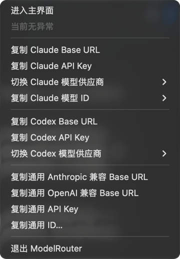

如果你使用的是 macOS 27 及更早版本，请先为菜单栏留出足够空间，避免菜单栏空间不足导致 ModelRouter 图标无法显示。

### 配置供应商

进入 ModelRouter 主界面，打开**供应商管理**，点击**添加供应商**。添加时需要填写供应商名称和对应的 API Key，并按需填写 Anthropic 或 OpenAI 兼容 BaseURL；至少需要填写一个端点。BaseURL 的具体地址请参照所配置供应商的官方文档。

**添加供应商**窗口如下：

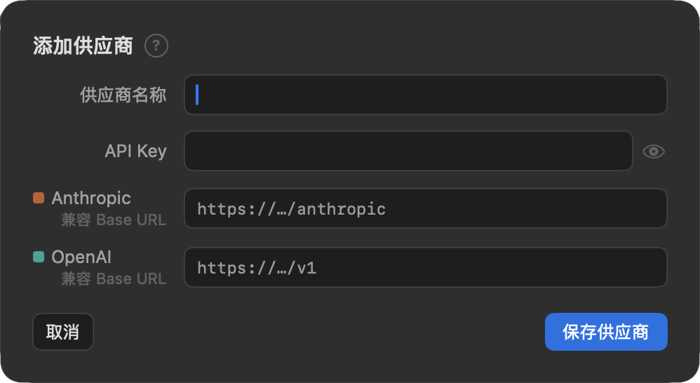

添加后点击**测试**，让 ModelRouter 检查对应 BaseURL 是否可用。测试状态会显示在供应商管理界面：

| 状态 | 含义 |
| --- | --- |
| 亮起 | 测试通过 |
| 灰色 | 测试未通过（BaseURL 检查失败） |
| 黄色 | 尚未测试 |

供应商管理界面如下；右侧每一行都会显示该供应商已登记的协议端点、模型入库数量，以及测试、编辑和删除操作：

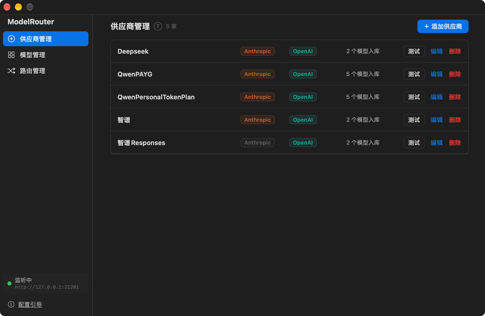

此处的测试针对 BaseURL，不等同于模型在某种 API 协议下的兼容性测试。测试失败的 BaseURL 不会进入可路由候选；未测试项会显示黄色提醒，但仍可继续配置。为了减少后续排错成本，建议在正式映射前先完成测试。

请优先使用供应商官方文档提供的原生端点。如果某个地址实际由第三方协议转换层暴露，它可能仍能通过 ModelRouter 的接入检查；但不建议如此配置。如果仍选择此方式，ModelRouter 不会对因此产生的错误提供支持。

供应商名称也会被用于通用路由模型 ID 的组成部分。若名称中包含中文，ModelRouter 会将其转换为大写拼音，因此建议使用全英文名称。

### 配置模型

进入主界面的**模型管理**，点击**添加模型**。填写模型 ID（请参照供应商文档）和模型名称。模型名称会在 Codex 接入配置、下拉菜单复制Display name等位置复用；如果模型要接入 Codex，建议模型名称使用 ASCII 字符。输入框右侧的按钮可以查看并复用已添加的模型 ID 和名称。

**添加模型**窗口如下：

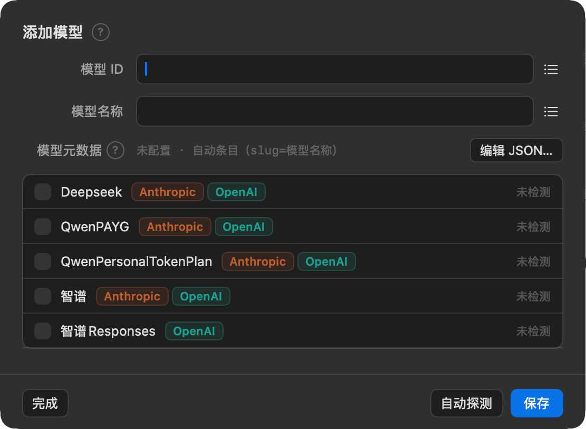

界面下半部分会列出已经添加的供应商，并显示其 Anthropic 与 OpenAI 兼容端点的配置/测试情况。这里显示的端点状态不代表某个模型已经通过对应 API 协议的测试。

#### 探测模型/API 兼容性

如果不确定某个模型 ID 在哪些供应商可用，可以点击**自动探测**；ModelRouter 会使用填写的模型 ID 遍历已添加的供应商并检查能否收到响应。若已知模型支持哪些供应商，也可以选择相应供应商后点击**探测**。

探测基于以下 API 的接入方式，并通过真实请求获取响应：

- Anthropic Messages API
- OpenAI Responses API
- OpenAI Chat Completions API

因此，探测会产生真实调用费用。单个端点单次探测使用最小真实请求，通常不超过 50 tokens；“自动探测”会遍历已勾选供应商的开放端点，总消耗会随供应商数量和端点数量增加。探测失败的模型/API 组合不会参与路由；未测试项会显示黄色提醒，但仍可按实际供应商文档手动配置。

#### 配置 Codex 模型元数据

如果要将模型接入 Codex，还需要配置模型元数据。在模型管理界面点击**编辑 JSON**，在编辑窗口中输入合法 JSON。模型提供商的文档通常会提供完整的 `model.json` 或同类文件；文件命名以供应商文档为准。

如果供应商提供的文件中包含多个模型对象，只需复制 `models` 数组中对应模型的对象到编辑窗口。配置完成后，点击**生成元数据**，再点击**应用**保存。

生成元数据时，ModelRouter 会将 `slug` 和 `display_name` 调整为你配置的模型名称；这三个值会保持一致。此操作不会影响模型推理性能。

如果供应商没有提供元数据，或你需要调整官方元数据，可以使用以下配置方式：

- **手动模式**：对元数据进行基础配置与修改。
- **高级模式（Beta）**：识别并显示已有元数据中的参数，允许通过 GUI 修改参数；也可以从**配置选项**中搜索参数名或参数描述，并将参数添加到元数据中。若内置选项未覆盖所需参数，也可以手动增补。

高级模式中的功能均为 Beta，当前版本不保证功能完善。编辑完成后，点击**生成元数据**，再点击**应用**。

Codex 元数据配置窗口如下；左侧可编辑或粘贴元数据，右侧显示规范化结果，下方可检查基础参数和推理档位：

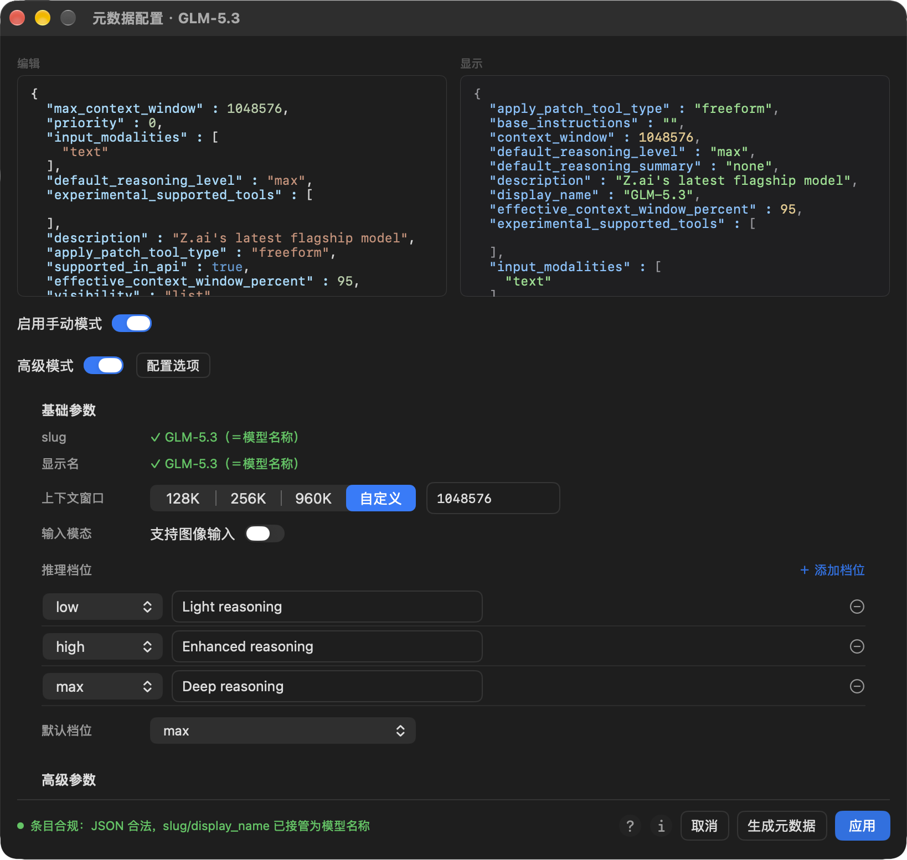

#### 模型管理列表

模型管理列表分为三级：

1. **一级：模型组。** 显示 `Messages`、`Responses`、`Completions` 标签。点击标签中的复制图表可复制该 API 对应的通用模型 ID；该 ID 的具体内容取决于为此 API 设置的默认供应商。点击**默认来源**可以分别设置各 API 的默认供应商。右侧菜单可用于重命名、配置模型元数据或删除整个模型组。
2. **二级：模型 ID。** 显示模型组下的模型 ID，右侧编辑按钮可以修改模型 ID 的相关信息。
3. **三级：供应商关联。** 显示支持该模型 ID 的供应商及其 API 测试状态，可复制对应供应商的通用模型 ID、重新测试或移除关联。

`Messages`、`Responses` 和 `Completions` 标签的状态含义如下：

| 状态 | 含义 |
| --- | --- |
| 亮起 | 支持/测试通过对应 API |
| 灰色 | 不支持/测试未通过对应 API |
| 黄色 | 尚未测试 |

每个 API 标签左侧还有一个小圆点：亮起表示该供应商是当前 API 的默认供应商，灰色表示不是默认供应商。

模型管理界面如下；可从上到下看到模型组、模型 ID 和供应商关联三级结构：

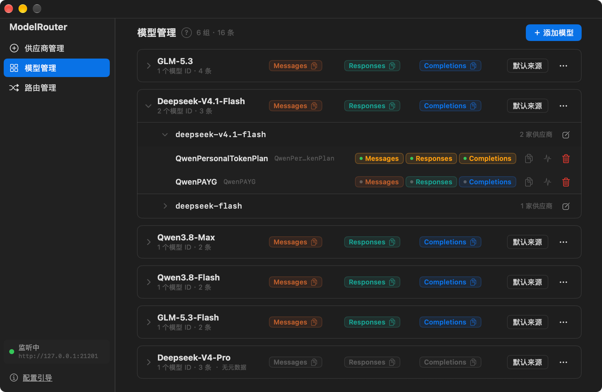

## 接入 Harness 工具

ModelRouter 提供 Claude 和 Codex 的专用配置界面，用于处理这类 Harness 对模型 ID、配置文件或模型元数据的特殊要求。其他支持自定义 API 端点的 Harness 工具可以使用通用路由。

### Claude

#### 基础配置

进入**路由管理**，找到 **Claude** 路由卡片，并确认已开启 Claude 路由。

ModelRouter 对 Claude 产品的接入方式均为 Gateway，只使用 Anthropic Messages API 侧可路由的模型和供应商。Anthropic 生态产品识别 Claude 系列模型 ID，因此需要将 Harness 发出的 Claude 模型 ID 映射到实际使用的模型和供应商。

ModelRouter 首次启动时会提供四个默认模型档位：`Fable`、`Opus`、`Sonnet` 和 `Haiku`，对应最新版本的 Claude 模型 ID。在请求模型列表中选择要映射的模型；列表显示的是模型管理中配置的模型名称。如果该模型设置了 Anthropic Messages API 的默认供应商，供应商字段会自动填写，否则需要手动选择。

- **模型锁定**：开启后禁止修改该行的“请求的模型”，避免误改模型映射；供应商字段仍可调整。
- **更新 ID 信息**：修改实际请求使用的 Claude 系列模型 ID。
- **添加模型位**：增加可映射的 Claude 模型 ID。Mythos、Fable、Opus 和 Sonnet 可使用官方 ID 或自定义定位；Haiku 不提供自定义定位，只能通过官方 ID 列表选择。

如果某个 Claude 模型位未映射，ModelRouter 会按档位关系尝试向下寻找最近一个已映射的低档位；若没有任何可用映射，请求会返回明确的未映射错误。

随着 Claude 更新，部分旧模型 ID 可能不再受支持，进而影响部分功能。官方 ID 清单会随 ModelRouter 版本更新；当前 ID 过旧时，界面会以红色提醒更新。ModelRouter 默认以最新版本的 Claude 为准。如果使用较旧版本的 Claude 客户端，默认提供的 ID 可能不受该客户端支持，此时可以根据客户端版本选择相应的官方旧版 ID，或自定义兼容的 ID。

当前版本的官方 ID 覆盖范围截至 **2026 年 10 月 8 日**：Haiku 4.5 及以上、Sonnet 5 及以上、Opus 4.8 及以上、Fable 5 及以上、Mythos 5 及以上。

Claude 路由卡片如下；每个模型位都会单独显示映射、锁定状态和更新入口：

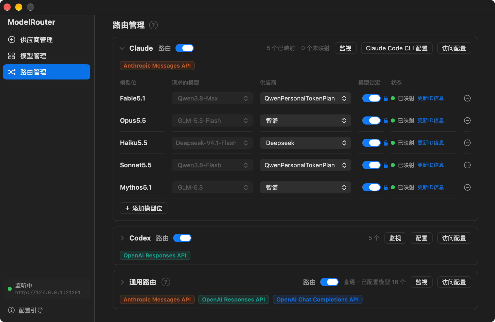

### Claude Desktop

目前 ModelRouter 仅支持 macOS，因此这里只说明 macOS 版 Claude Desktop 的接入方式。

1. 启动 Claude Desktop，在菜单栏打开 **Help → Troubleshooting → Enable Developer Mode**。
2. 在确认弹窗中选择 **Enable**，等待 Claude Desktop 重启。
3. 在菜单栏打开 **Developer → Configure Third-Party Inference**。
4. 在 **Connection** 中设置：
   - Connection：`Gateway`
   - Credential kind：`Static API key`
   - Gateway base URL：从 ModelRouter 菜单栏菜单中复制 **Claude Base URL** 后粘贴
   - Gateway API key：从 ModelRouter 菜单栏菜单中复制 **Claude 本地访问 Key** 后粘贴
   - Gateway auth scheme：`bearer`

**Connection** 页面的配置位置如下：

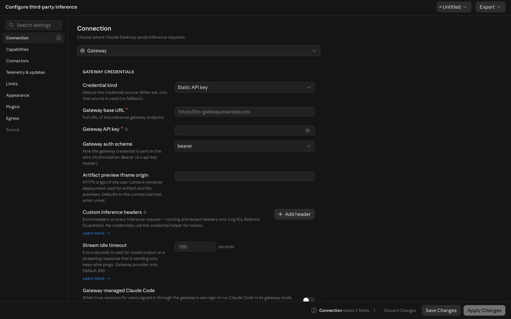

5. 在 **Model list** 中点击 **Add**，添加模型配置卡片。
6. 从 ModelRouter 菜单栏菜单的**复制 Claude 模型 ID**子菜单中，找到所需模型并复制其 Model ID 和 Display name，分别粘贴到 Claude Desktop 的对应字段中。需要添加更多模型时，重复此步骤。

**Model list** 的配置位置如下：

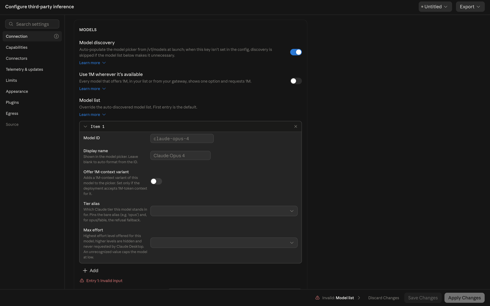

7. 点击 **Save Changes**，再点击 **Apply Changes**，等待 Claude Desktop 重启。

上述步骤默认保留 **Configure Third-Party Inference** 中其他设置的默认状态；某些功能可能需要额外配置。在配置过程中，推荐打开 **Capabilities** 检查两项设置：

- 打开 **Disable Claude.ai sign-in**，确认第三方 Gateway 接入不与 Claude.ai 登录状态混用。
- 如果会使用 webfetch 或其他需要外联的功能，在 **Allowed egress hosts** 中添加实际需要访问的地址。建议允许确有需要的来源，不建议无差别放开所有地址。

这是我们推荐的配置做法。你可以根据需要调整 **Configure Third-Party Inference** 中的其他配置；ModelRouter 不会修改、覆盖或删除你在 Claude Desktop 中的其他配置。

### Claude Code CLI (Beta)

请先确认已安装 Claude Code CLI。进入 ModelRouter 主界面的**路由管理**，找到 Claude 路由卡片，点击**Claude Code CLI 配置**。

#### 快速配置

点击左下角的**快速配置**。ModelRouter 会写入 7 个环境变量，并通过 `modelPicker` 完成模型接入与映射配置。快速配置时需要设置：

- 子代理模型
- 思考等级
- `auto-compact` 窗口

你也可以编辑 `modelPicker` 中的 `label` 和 `description`：前者是模型显示名称，后者是模型描述。`modelPicker` 中的 Claude 官方模型 ID 及其映射关系会与 Claude 路由卡片中的配置保持一致。

点击确认写入后，配置会进入 `~/.claude/settings.json` 的副本。ModelRouter 中的编辑操作始终针对副本；只有在配置主界面点击**保存**，改动才会写入实际的 `~/.claude/settings.json`。

#### 复原配置

- **半复原**：移除 ModelRouter 接管的 7 个环境变量和 `modelPicker` 配置，保留其他设置。
- **彻底复原**：清空整个 `settings.json`。此操作具有破坏性，必须二次确认。

#### 配置字典

配置字典收录可在 `settings.json` 中配置的环境变量和设置选项。可以按参数名称或描述搜索，并查看参数名、说明、示例及对应的官方文档。环境变量和设置分为不同栏目；点击**访问官方支持文档**会打开对应类别的资料。

所有改动只会在点击**保存**时生效，并且只有在 ModelRouter 检查到 JSON 合法时才能保存。

Claude Code CLI 配置窗口如下；上方是 JSON 编辑区，底部集中放置快速配置、复原和保存入口：

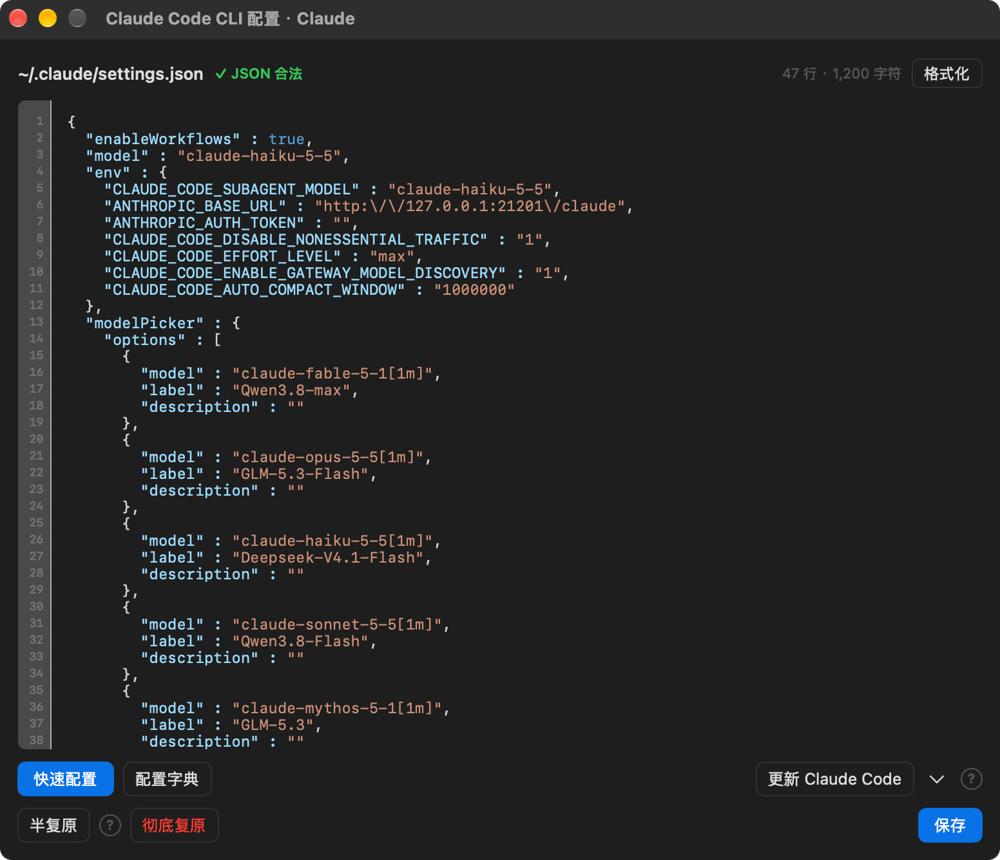

### Codex (Beta)

Codex 接入相关功能目前标记为 Beta。

Codex 路由卡片如下；展开后可为每个请求模型单独选择供应商：

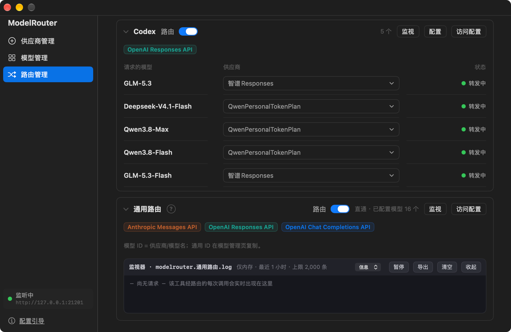

#### 配置须知

Codex 配置包含两个部分：模型元数据文件 `model_modelrouter.json` 和系统配置文件 `config.toml`。如果希望 Codex 正确识别模型能力，需要向 Codex 提供对应的模型元数据。

如果没有为模型配置元数据，ModelRouter 仍会提供一份最小可用元数据，让模型能够接入 Codex；但这份元数据可能与实际模型能力不匹配。请查看模型供应商的支持文档获取元数据，并在模型管理界面中录入。

配置编辑操作均针对文件副本，只有点击**保存**后才会写入原始文件。

#### 配置 Codex

Codex CLI、Codex 桌面版和 Codex VS Code 插件读取同一位置的 `config.toml`。在路由管理界面找到 Codex 路由卡片，进入**配置**：

1. 点击**添加模型**，选择要接入 Codex 的模型。
2. 点击**快速配置**，写入基本接入配置。此操作会接管以下 8 个参数，并通过注释将其单独标示：
   - `model_provider`
   - `model_catalog_json`
   - `model`
   - `forced_login_method`
   - `name`
   - `base_url`
   - `wire_api`
   - `experimental_bearer_token`
3. 点击**设置思考模式**，完成 Codex 配置。若未设置思考模式，元数据中实际存在的部分思考档位可能不会在 Codex 中显示。
4. 点击**保存**应用变更，并重启或重新加载正在使用的 Codex 客户端，例如 Codex CLI、桌面版或 VS Code 插件。

**恢复 OpenAI 登录**会退出 Gateway 接入，移除 ModelRouter 接管的上述参数，使 Codex 回到 OpenAI 官方登录路径。ModelRouter 不提供多账号管理。`config.toml`由ModelRouter和Codex共同管理，你的部分设置可能会由Codex写入`config.toml`，并且这些更改可能会出现在标记的管制区内，或者更改收到管制的参数，这是正常现象。

#### 配置字典与元数据预览

**配置字典**列出 `config.toml` 中可配置的参数，支持按参数键名或描述搜索；条目内容来自官方文档，并提供在线支持文档入口。

点击 **`model_modelrouter.json` 预览**，可以查看当前添加的模型所组成的元数据文件。

Codex 配置窗口如下；受管区位于文件上方，添加的模型、默认模型和操作按键集中在下方：

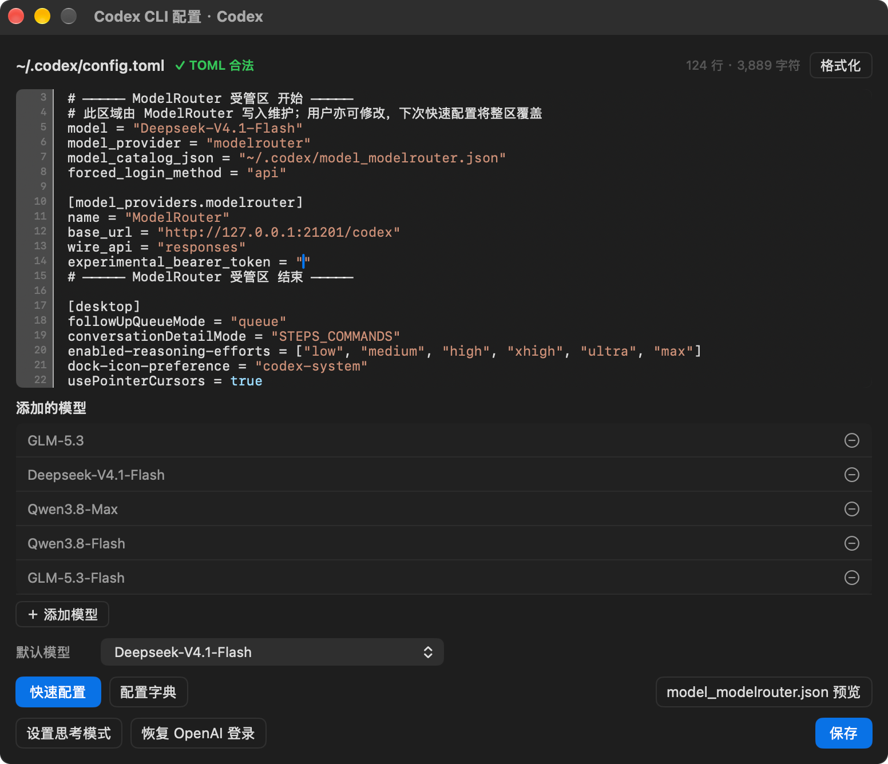

### 使用通用路由

通用路由适用于支持自定义 API 来源的 Harness 工具。ModelRouter 提供两个兼容端点：

- **Anthropic 兼容 BaseURL**：提供 Anthropic Messages API 接入。
- **OpenAI 兼容 BaseURL**：提供 OpenAI Responses API 和 OpenAI Chat Completions API 接入。

ModelRouter 提供的通用模型 ID 可用于这两个接入地址。ModelRouter 会根据模型管理中记录的各模型与供应商的 API 测试情况，将请求下发至相应供应商；两个地址均支持模型发现功能。

可以从模型管理界面或菜单栏下拉菜单复制通用路由的 BaseURL 和本地访问 Key，也可以通过模型管理界面或菜单栏中的**复制通用 ID**获取通用模型 ID。

一个通用模型 ID 只对应一个模型在一个供应商处的配置。将其用于其他 Harness 工具前，请确认以下配置一致：

- BaseURL
- 上游 API 协议
- 本地访问 Key
- 支持该 API 协议的通用模型 ID
- ModelRouter 中对应的路由开关已开启

如果以上配置正确，并且 Harness 工具的连接测试通过，即代表基础接入配置完成。基础接入成功并不代表不同供应商提供的工具或其他附加能力完全一致。

## 监视器与日志

ModelRouter 为所有路由路径提供日志监视器。进入**路由管理**并点击**监视**，即可查看日志。

如果遇到问题，可以点击监视器中的**导出**，将日志保存到指定的本地目录。日志记录范围有限，保留最近 2000 条请求；导出界面还提供不同的日志范围选项，包括最近一小时。

提交 Issue 时，可以附上导出的日志文件，帮助分析问题。分享前请确认日志内容适合公开提交。

监视器界面如下；每条记录只显示时间、状态、耗时和回传大小等路由信息：

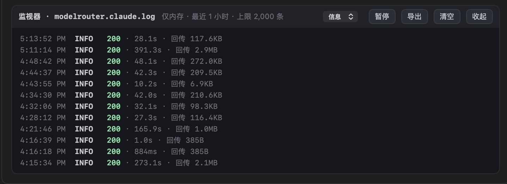

## 错误处理

### 大型会话切换供应商

切换供应商时，Harness 可能需要把完整对话上下文重新发送给新供应商。在目前有限的测试中，Codex 已出现 `Request exceeds the 512 MiB RPC message limit`，并且重启 Harness 工具无法解决该问题。该错误来自新服务端的请求大小校验，不是模型 Token 上限；它可能在任何通过 ModelRouter 直接切换供应商的 Harness 工具（Codex 和 Claude）中出现。

### 排查方法

遇到该错误时，请检查上下文窗口占用情况，并确认历史对话中是否包含大体积文件、长工具输出或其他大体量内容。如果是，说明对话内容过于庞大，导致新服务端拒绝了请求；此时压缩上下文即可解决。

## 安全与 Key 管理

ModelRouter 只监听本机回环地址 `127.0.0.1`，不默认暴露到局域网。

客户端不会接触供应商真实 API Key。客户端只使用 ModelRouter 生成的本地访问 Key；ModelRouter 收到请求后，再使用对应供应商的真实 Key 请求上游。

- Claude、Codex 和通用路由分别使用独立本地访问 Key；
- 本地访问 Key 可以重新生成；
- 重新生成后，客户端需要更新为新 Key；
- 供应商真实 API Key 保存在本地受保护存储中；
- 请勿将本地访问 Key 或供应商 API Key 发布到公开 Issue、截图或日志中。

日志仅用于本地问题排查，保留条目数量有限。提交 Issue 前请先检查导出日志是否包含敏感信息。

## 安全相关测试

ModelRouter 提供一组 XCTest 回归测试，用来固定与安全相关的行为边界。
这些测试主要用于公开复现和第三方审阅，不构成完整的安全审计或渗透测试。

当前测试包含：

- 4 个测试套件；
- 17 个 XCTest 方法；
- 228 条安全与行为断言。

测试覆盖以下重点：

| 测试域 | 覆盖内容 |
|---|---|
| 路由与鉴权 | 缺失 Authorization、非 Bearer 形态、未知本地访问 Key 的拒绝行为 |
| 上游请求改写 | 客户端凭证剥离、供应商真实 Key 注入、`Host` 与 hop-by-hop 头剥离、自定义头透传 |
| 路由语义 | 未映射模型不猜测、降级只发生在显式配置的档位链、悬挂引用不短路降级 |
| Codex 受管区 | 受管区只替换声明范围、区外内容保留、废弃键清除、写入前后状态可判定 |
| 安全写盘 | 新建文件 0600、既有文件权限保持、原子写入、备份文件 0600、备份数量限制 |
| Claude 档位 | 官方 ID、档位降级、删除后语义、模型位更新不破坏既有映射 |
| 元数据处理 | 元数据结构识别、编辑与回写行为，避免用户已有结构被静默破坏 |

### 运行测试

使用 Xcode 打开 `ModelRouter.xcodeproj` 后，选择 `ModelRouter` Scheme，按 `Cmd-U` 运行测试。

也可以使用命令行：

```bash
xcodebuild -project ModelRouter.xcodeproj \
  -scheme ModelRouter \
  -destination 'platform=macOS' \
  -derivedDataPath .build/test \
  test
```

`./build.sh` 用于 Release 构建和 DMG 打包，不会运行测试。

### 测试隔离

共享 Scheme 已设置独立的测试环境变量：

```text
MR_CONFIG_PATH=/tmp/mr-test-host/config.json
MR_KEYSTORE_DIR=/tmp/mr-test-host/keys
MR_CODEX_CONFIG_PATH=/tmp/mr-test-host/codex/config.toml
MR_CODEX_CATALOG_PATH=/tmp/mr-test-host/codex/catalog.json
MR_CODEX_BACKUP_DIR=/tmp/mr-test-host/codex-bak
MR_USER_DICT_PATH=/tmp/mr-test-host/user-dict.json
```

因此测试不会读取或改写真实的：

```text
~/.claude/settings.json
~/.codex/config.toml
~/.codex/model_modelrouter.json
```

测试中的 Key、Token 和供应商凭证均为构造数据，例如 `mr-test`、`sk-test-vendor`。
请不要向测试代码、测试数据、Issue 或截图中添加真实 API Key 或本地访问 Key。

### 修改安全敏感逻辑时

如果你修改以下区域，建议先运行完整测试：

- 请求路径识别；
- 本地访问 Key 校验；
- 上游请求头改写；
- 供应商 Key 注入；
- Claude settings 写入；
- Codex 受管区写入；
- 模型目录生成；
- TOML 解析；
- 文件权限、原子写入或备份逻辑。

新增测试时，请继续使用临时目录和构造数据，不要依赖真实用户配置。

## License

ModelRouter is released under the [MIT License](LICENSE).

Copyright (c) 2026 Lynna-498
